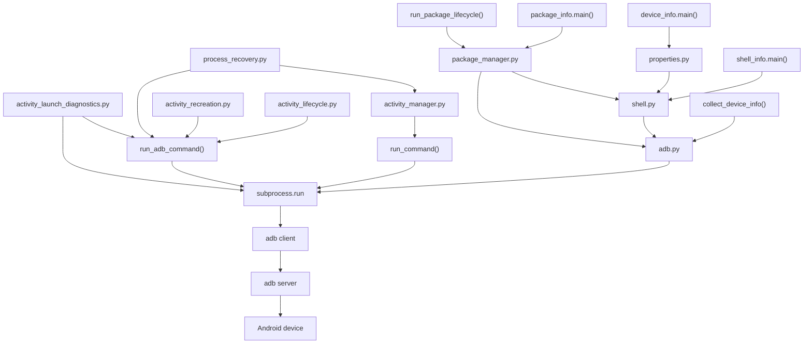

# Architecture

The Python modules build ADB commands, parse their output, and print device reports as JSON.
Package, property, and general shell commands pass through `run_adb()` in `adb.py`.
Activity Manager uses its own `run_command()` to retain exit status, stdout, and stderr.
Activity lifecycle observation uses `run_adb_command()` with a per-command timeout,
then parses Logcat snapshots and matches ordered callback sequences.




The diagram shows the ADB execution paths for reports and Activity helpers. All three `main()` functions also call
`adb.list_devices()` to choose the first device whose state is `device`.

## Modules

| Module | Responsibility |
| --- | --- |
| [`activity_launch_diagnostics.py`](../src/android_cookbook/activity_launch_diagnostics.py) | Parse optional launch timings and Displayed events, query a single PID, and validate controlled launch observations |
| [`process_recovery.py`](../src/android_cookbook/process_recovery.py) | Parse PID-aware state events, poll process changes, resume launcher tasks, and validate recovery |
| [`activity_recreation.py`](../src/android_cookbook/activity_recreation.py) | Parse state snapshots, poll predicates, control and restore rotation settings, and validate restored state |
| [`activity_lifecycle.py`](../src/android_cookbook/activity_lifecycle.py) | Read and parse fixture lifecycle logs, poll ordered events, send Home/Back, and request graceful finish |
| [`activity_manager.py`](../src/android_cookbook/activity_manager.py) | Start activities, force-stop packages, query process IDs, and collect activity diagnostics |
| [`adb.py`](../src/android_cookbook/adb.py) | Run ADB, list devices, and provide the original property reader |
| [`shell.py`](../src/android_cookbook/shell.py) | Run commands on a selected device and parse shell output |
| [`package_manager.py`](../src/android_cookbook/package_manager.py) | Query packages and APK paths; install, uninstall, clear, enable, and disable apps |
| [`package_lifecycle.py`](../src/android_cookbook/package_lifecycle.py) | Sequence package operations and return lifecycle observations |
| [`package_info.py`](../src/android_cookbook/package_info.py) | Select a device and print a package report as JSON |
| [`properties.py`](../src/android_cookbook/properties.py) | Read and parse properties; collect a device report |
| [`device_info.py`](../src/android_cookbook/device_info.py) | Select a device and print its properties as JSON |
| [`shell_info.py`](../src/android_cookbook/shell_info.py) | Select a device and print shell information as JSON |

### ADB execution

`run_adb(*args)` calls `subprocess.run(["adb", *args], capture_output=True, text=True,
check=True)`. It returns standard output with surrounding whitespace removed.

`list_devices()` reads `adb devices` output. It skips the header, blank lines, and rows with
fewer than two columns. Each accepted row becomes an `AdbDevice(serial, state)`.
Offline and unauthorized devices remain in the list; callers decide which state to use.

### Shell commands

`run_shell(serial, *command)` adds `-s <serial> shell` before the command arguments.
For example:

```python
run_shell("emulator-5554", "uname", "-a")
```

runs `adb -s emulator-5554 shell uname -a` and returns a `ShellResult` with two fields:

- `command`: the arguments joined with spaces, such as `uname -a`.
- `output`: the text returned by `run_adb()`.

The joined string is for display. Process execution uses the argument list.

| Helper | Command | Result |
| --- | --- | --- |
| `get_working_directory()` | `pwd` | String |
| `get_current_user()` | `whoami` | String |
| `get_kernel_info()` | `uname -a` | String |
| `list_root_directory()` | `ls /` | List of stripped, non-empty lines |

### Property reads

`properties.get_property(serial, name)` runs `getprop <name>` through `run_shell()` and
strips its output. `get_all_properties(serial)` runs `getprop` once and parses the listing.

`collect_device_properties(serial)` makes eight separate property reads and returns
`DeviceProperties`. It converts `sdk_level` with `int()` and leaves the other values as
strings. It does not cache results or use the bulk listing. See the
[property reference](receipes/v0.3-properties.md#common-properties) for field mappings.

The older `adb.get_property(serial, property_name)` calls `run_adb()` directly. It remains
in use by `collect_device_info()` and the v0.1 tests.

### Property parsing

The parsing functions do not call ADB:

- `parse_properties(output)` strips each line, skips blank lines, and calls
  `parse_property_line()`. It keeps accepted entries in order, including duplicate names.
- `parse_property_line(line)` requires a leading `[` and the exact separator `]: [`.
  It splits at the first separator, removes the opening bracket from the name, and removes
  a final `]` from the value if present. It returns `None` when either initial check fails.

The parser accepts empty names, empty values, and missing closing brackets. When called
directly, `parse_property_line()` does not strip surrounding whitespace.

`AdbDevice`, `ShellResult`, `AndroidProperty`, and `DeviceProperties` are frozen dataclasses:
their fields cannot be reassigned after creation. `ProcessInfo` is also defined in `shell.py`
but is not used.

### Package management

`list_packages()` builds `pm list packages` with optional `-s`, `-3`, `-e`, `-d`, and a
name filter, then calls `run_shell()`. Mutually exclusive system/third-party or
enabled/disabled filters raise `ValueError` before execution. `package_exists()` uses the
filtered listing and compares full names for an exact match.

`parse_package_line()` strips whitespace and requires `package:` followed by a non-empty
name. `parse_package_list()` skips rejected lines and preserves order and duplicates.
`parse_package_paths()` applies the same prefix and non-empty checks to paths and returns
`PackagePath(package_name, paths)`, including all split APK paths. These parsers do not
validate package-name syntax or check whether a path exists.

`get_package_path()`, `clear_package()`, `enable_package()`, and
`disable_package_for_user()` issue `pm` commands through `run_shell()`. Clear returns a
Boolean based on an exact `Success` response; enable and disable return stripped output.
Only the disable helper exposes `user_id`, defaulting to `0`.

`install_apk()` checks that the host path exists, then calls `run_adb()` with
`-s <serial> install`, optional `-r`, `-t` (`allow_test_packages=True`), and `-g`, and the path. `uninstall_package()` calls
`run_adb()` with `-s <serial> uninstall`, optional `-k`, and the package name.
Both return stripped standard output. They do not catch command failures.

`PackageInfo` and `PackagePath` are frozen dataclasses. Fields cannot be reassigned,
though the list stored in `PackagePath.paths` can still be modified.
See the [package recipe](receipes/v0.4-package-manager.md) for commands and return values.

### Package lifecycle

`run_package_lifecycle(serial, apk_path, package_name)` calls package manager helpers in
this order: install with `replace=True` and `allow_test_packages=True`, check existence, read APK paths, clear, check
existence, uninstall without retaining data, and check absence. It returns a frozen
`PackageLifecycleResult` containing the package name, APK paths, and five Boolean observations.
The path list remains mutable. Installation output is ignored; the uninstall flag requires
stripped output to equal `Success`.

The helper does not assert success, validate the APK package name, or provide a CLI.
Exceptions pass through, and there is no guaranteed cleanup if a command raises before
uninstallation. Integration fixtures provide separate setup and teardown around tests.
See the [lifecycle recipe](receipes/v0.4.1-package-lifecycle.md) for fields and examples.

### Activity Manager

`activity_manager.py` calls `subprocess.run()` directly through `run_command()` with
`check=False`, UTF-8 decoding, and replacement of invalid bytes. It uses argument lists
without a host shell and returns a frozen `CommandResult` with `args`, `returncode`,
`stdout`, and `stderr`. `_adb_shell()` adds `adb -s <serial> shell` and rejects blank serials.

`start_activity()` builds `am start [-S] -W -n <package>/<activity>` and combines stdout
and stderr for parsing. Success requires exit code zero, `Status: ok`, and no matching
error line. It returns a frozen `ActivityStartResult`; missing or non-integer timing
fields become `None`. Launch failures raise `ActivityManagerError`.

`force_stop_package()` runs `am force-stop` and returns `None`. `get_process_ids()` runs
`pidof` for the exact process name and returns integer PIDs. A nonzero exit with both
streams empty returns `[]`; other nonzero exits and non-integer PID output raise
`ActivityManagerError`. `is_process_running()` converts that list to a Boolean.
`get_activity_dump()` returns raw stdout from `dumpsys activity activities`.
Force-stop and dump commands raise `ActivityManagerError` on nonzero exit.

Package identifiers are validated before package operations, and `make_component()`
accepts a single relative activity name such as `.MainActivity`. The current regexes
use `[A-Za-z0-0_]` for trailing characters in package segments after the first and in
activity names, so digits 1–9 are rejected there. Fully qualified activity names and
nested relative names are also rejected. These are implementation limits, not a complete
Android component-name validator. See the [recipe](receipes/v0.5.0-activity-manager.md).

### Activity lifecycle observation

`activity_lifecycle.py` runs `adb -s <serial>` directly through `run_adb_command()`.
It rejects blank serials and uses UTF-8 decoding with replacement, `check=False`, and
a 20-second command timeout. It returns stdout unchanged. Nonzero exits and subprocess
timeouts become `LifecycleError`; missing ADB remains `FileNotFoundError`.

The fixture's `MainActivity` logs seven callbacks with tag `CookbookLifecycle`, marker
`android-cookbook-v0.5.1`, and a UUID per instance. `clear_logcat()` clears the shared
buffer. `read_lifecycle_logcat()` reads a snapshot with `logcat -d -s CookbookLifecycle:I '*:S'`.
`parse_lifecycle_events()` accepts matching marker/instance/event fields in that order,
ignores unrelated lines and unknown callbacks, and returns frozen `LifecycleEvent`
objects in log order. Instance text accepts hexadecimal characters and hyphens without
full UUID validation.

`wait_for_lifecycle_sequence()` parses each snapshot afresh and matches an ordered
subsequence, allowing intervening callbacks. It defaults to a 10-second observation
timeout and 0.2-second polling interval. An optional instance ID filters matching,
but the returned events include every parsed instance. Timeout errors report expected
and actual names. Individual ADB reads can extend elapsed time past the observation
deadline. Negative observation timeouts and nonpositive intervals raise `ValueError`.
`find_created_instance()` returns the first creation instance or raises `LifecycleError`.

`send_keyevent()` permits only Home and Back. `request_activity_finish()` starts the
fixture component with `--activity-single-top --ez cookbook_finish true`. The foreground
Activity handles this extra in `onNewIntent()` and calls `finish()`. Force-stop does
not supply an equivalent callback guarantee. These helpers provide no CLI.
See the [v0.5.1 recipe](receipes/v0.5.1-activity-lifecycle.md) for commands and limitations.

### Activity recreation

`activity_recreation.py` shares the lifecycle ADB runner and its 20-second timeout.
`parse_state_events()` returns frozen `StateEvent` objects from `CookbookState` lines
with marker `android-cookbook-v0.5.2`. The parser reads instance, event, counter,
orientation, and restored in order. It accepts the trailing PID field emitted by the current fixture. Counters are nonnegative integers; orientation accepts
`portrait`, `landscape`, or `undefined`. Event names accept lowercase letters without
an allowlist. `wait_for_state_event()` returns the first predicate match in a snapshot,
including older matching events. It defaults to 15 seconds and a 0.2-second interval;
an individual ADB read can overrun the polling deadline.

`set_user_rotation()` runs `wm user-rotation lock <rotation>` with a value from 0 to 3.
`capture_rotation_settings()` records both rotation keys; missing or `null` values become
`None`. Restoration handles `user_rotation` first, then `accelerometer_rotation`, deleting
keys that were absent. Restoration is sequential and exceptions propagate.
`send_fixture_action()` sends `increment` or `report` to the foreground singleTop fixture.
`assert_state_restored()` requires a different instance, equal counter, `restored=True`,
and different orientation; it does not verify process identity or event names.

The shared `controlled_rotation` fixture captures settings and attempts restoration in
`finally`. Each test first launches the Activity, observes creation, then requests rotation
0 and waits for a portrait creation event. This setup may recreate the Activity, so the
zero-counter baseline permits restored state. Two destructive integration tests rotate
from that portrait baseline to landscape: one checks counter 5, saved state and
per-instance lifecycle sequences;
the other checks recreation and continued package installation. These tests do not
assert PID continuity or read settings back after teardown. Unit tests cover parsing,
restoration invariants, rotation command construction, capture/restore behavior, polling,
timeout, and increment command extras. See [Activity recreation](receipes/v0.5.2-activity-recreation.md).

### Process death and state recovery

`process_recovery.py` uses the lifecycle ADB runner for commands and Logcat, and
`activity_manager.get_process_ids()` for process observation. The latter uses the
Activity Manager execution path. `ProcessStateEvent` adds PID to the state fields;
`RecoveryResult` records before/after PIDs, UUIDs, counters, and the restored flag.
The parser requires `CookbookState`, the v0.5.2 marker, and ordered fields ending in
`pid`. `read_process_state_events(serial)` reads the selected device with a Logcat filter
for `CookbookState`.

`wait_until()` defaults to 10 seconds and a 0.2-second interval. It evaluates once even
with a zero timeout, returns a Boolean, and validates timeout/interval arguments.
`wait_for_process_absent()` checks for no PIDs; `wait_for_new_process()` selects the
first PID different from the old one or raises `LifecycleError`. State-event polling
defaults to 15 seconds, returns the first snapshot predicate match, and raises
`LifecycleError` on timeout. Individual ADB operations can exceed polling deadlines.

`request_background_process_kill()` issues `am kill` without verifying termination.
`launch_from_launcher()` uses MAIN/LAUNCHER and `0x10200000`
(`NEW_TASK | RESET_TASK_IF_NEEDED`). Integration setup and relaunch use this same
intent so recovery can resume the saved task. `evaluate_recovery()` checks different
PIDs and UUIDs and a new `created` event; `assert_state_recovered()` separately checks
restored state and counter equality.

Three destructive integration tests verify process death without uninstalling, restored
counter 5 after task relaunch, and force-stop without uninstalling. Preparation force-stops
before a fresh launch, increments, presses Home, and waits for saved state. Recovery
has no intervening force-stop. If `am kill` does not remove the process within 10 seconds,
the tests skip; that is incomplete commit verification. Shared fixtures install the
rebuilt APK, clear Logcat, then force-stop and uninstall during teardown.
See [Process recovery](receipes/v0.5.3-process-death-recovery.md) and the
[rotation root cause and solution](receipes/v0.5.2-activity-recreation.md#v053-rotation-fix-root-cause-and-solution).

### Activity launch diagnostics

`activity_launch_diagnostics.py` launches with `adb -s <serial> shell am start -W -n
<component>` using a 30-second timeout. It does not force-stop during launch.
`LaunchResult` retains optional status, launch state, component, integer timing fields,
warning lines, raw stdout, and host monotonic elapsed time. Invalid timing fields, failed
exits, launch timeouts, leading stdout errors, and non-ok status raise `LaunchError`; absent status is
accepted. Missing ADB remains `FileNotFoundError`.

`get_app_pid()` runs `pidof` separately with a 10-second timeout. Empty output with exit
code 0 or 1 returns `None` based on stdout alone; multiple PIDs, invalid integers, and other nonzero exits raise
`LaunchError`. PID timeouts remain `subprocess.TimeoutExpired`. Force-stop and graceful
finish use the lifecycle runner's 20-second timeout.

`LaunchObservation` combines caller-supplied PID, UUID, creation evidence, expected type,
and result. `assert_launch_type()` validates cold/warm/hot preconditions without using
platform launch state or timing thresholds. Integration tests gather lifecycle and state
logs through existing helpers. Displayed parsing accepts supplied text only; integration
tests do not collect Displayed events or export timing reports.

`wait_until()` invokes its predicate immediately and retries at the configured interval
(default 0.2 seconds) until success or timeout (default 10 seconds). A zero timeout still
evaluates once. It validates timeout/interval arguments, returns a Boolean, and propagates
predicate exceptions. Individual predicate calls can exceed the deadline. Unit tests
verify retries and timeout behavior with a simulated clock.

Unit tests cover valid cold, warm, and hot classifications, four invalid observations,
and Displayed durations with and without seconds plus unrelated log lines. See the
[v0.5.4 recipe](receipes/v0.5.4-activity-launch-diagnostics.md#run-the-tests) for commands.

### Test APK build flow

The Android project in `fixtures/test-app` supplies the disposable package used by
integration tests. `scripts/build-test-apk.sh` runs `./gradlew assembleDebug` in that
project, then copies `app/build/outputs/apk/debug/app-debug.apk` to
`tests/fixtures/test-app/cookbook-test-app.apk`. The APK is generated locally and ignored
by Git. Building requires JDK 17 and the Android Environment SDK with Platform 36 and
Build Tools 36.0.0; running the tests also requires an online Android device.
See [Build the test APK](receipes/v0.4.2-test-apk-fixture.md#build-the-test-apk).

## JSON commands

All three entry points select the first online device. If none is available, they raise
`RuntimeError("No Android device available")`.

`device_info.main()` calls `collect_device_properties()`, converts the result with `asdict()`,
adds `serial`, and prints indented JSON. The output includes the integer field `sdk_level`.
See the [JSON example](receipes/v0.3-properties.md#4-print-json).

The older `collect_device_info()` helper returns string fields `serial`, `model`,
`android_version`, `sdk`, and `build`. The entry point no longer calls it.

`shell_info.main()` prints `serial`, `user`, `cwd`, `kernel`, and `root_directories`.
It currently calls `get_kernel_info()` for both `cwd` and `kernel`, so those fields contain
the same kind of output. The working-directory helper is implemented but is not called here.

`package_info.main()` requires `--package`, selects an online device, and calls
`package_exists()`. It reads paths only for an installed package and prints `serial`,
`package`, `installed`, and `apk_paths`. An absent package has `installed: false` and an
empty path list. See the [package JSON example](receipes/v0.4-package-manager.md#3-print-a-package-report).

## Error handling

Errors pass through to the caller:

| Condition | Exception |
| --- | --- |
| ADB executable is missing | `FileNotFoundError` |
| General ADB wrapper exits with a non-zero status | `subprocess.CalledProcessError` |
| Activity lifecycle ADB command times out or exits nonzero | `LifecycleError` |
| Expected Activity callbacks are not observed | `LifecycleError` |
| APK path does not exist on the workstation | `FileNotFoundError` |
| Package filters conflict | `ValueError` |
| Required `--package` argument is omitted | `argparse` exits with status 2 |
| SDK output cannot be converted to an integer | `ValueError` |
| A JSON command finds no online device | `RuntimeError` |

Activity lifecycle calls have a 20-second command timeout and wrap nonzero exits and
timeouts in `LifecycleError`. Launch diagnostics have 30-second launch and 10-second
PID timeouts as described above. Other ADB wrappers have no timeout. The JSON commands have no option for choosing a serial;
the Python helpers accept one explicitly.

## Tests

Unit tests replace process or device calls with sample responses. Integration tests run
ADB on the selected emulator or discover an online device, depending on the test.

| Test file | Checks |
| --- | --- |
| `tests/unit/test_activity_launch_diagnostics.py` | Timing and Displayed parsing, cold/warm/hot and invalid classifications, launch command and timeout, PID lookup, finish arguments, and polling success/timeout/validation/error propagation |
| `tests/integration/test_activity_launch_diagnostics.py` | Three destructive cold/warm/hot scenarios, PID and UUID checks, lifecycle sequences, and optional timing collection; warm/hot can skip on lost processes |
| `tests/unit/test_process_recovery.py` | PID-aware parsing, log tag filter, process polling, launcher flags, kill command, and recovery assertion failures |
| `tests/integration/test_process_recovery.py` | Three destructive tests: background death, saved counter restoration, and force-stop without uninstalling |
| `tests/unit/test_activity_recreation.py` | State parsing, restoration assertions, rotation settings, polling, timeout, and increment action arguments |
| `tests/integration/test_activity_recreation.py` | Two destructive tests: saved counter restoration with per-instance callbacks, and recreation without uninstalling |
| `tests/unit/test_activity_lifecycle.py` | Log parsing, instance filtering, subsequences, creation lookup, polling and timeout, key events, and finish command construction |
| `tests/integration/test_activity_lifecycle.py` | Four destructive tests: launch, Home, return from Home, and graceful finish, correlated by instance UUID |
| `tests/unit/test_activity_manager.py` | Component validation, launch parsing and command flags, launch/force-stop errors, PID lookup, and diagnostics |
| `tests/integration/test_activity_manager.py` | Five destructive tests: launch, process creation, force-stop without uninstall, restart, and non-empty diagnostics |
| `tests/unit/test_adb.py` | Device parsing, offline state, and property command arguments |
| `tests/unit/test_shell.py` | Shell arguments, result fields, user, working directory, and root entries |
| `tests/unit/test_properties.py` | Property parsing, read arguments, output trimming, and collection with an integer SDK |
| `tests/unit/test_package_manager.py` | Package parsing, list arguments, conflicting filters, existence, APK paths, clear responses, install options, missing APKs, and basic uninstall |
| `tests/unit/test_package_lifecycle.py` | Successful result and package operation order with mocked helpers |
| `tests/unit/test_package_lifecycle_state_machine.py` | Generated install/enable/disable/clear/uninstall sequences against an in-memory fake; 100 examples × up to 30 steps |
| `tests/integration/test_package_lifecycle_state_machine.py` | Same intended model against real package manager helpers; 3 examples × up to 5 steps; skips for a missing/empty APK or no online device |
| `tests/integration/test_package_lifecycle.py` | Install, APK paths, clear without removal, uninstall, and full sequence; requires the built fixture APK and the selected emulator |
| `tests/integration/test_fixutre_apk.py` | Destructive APK smoke test: install with `-t` and verify package presence |
| `tests/integration/test_package_manager.py` | Package listing, Settings existence and APK paths, and system packages |
| `tests/integration/test_device.py` | Device discovery and numeric SDK output |
| `tests/integration/test_shell.py` | Shell user, Linux kernel output, and a `system` root entry |
| `tests/integration/test_properties.py` | Model, SDK, Android version, property listing, and collected report |

Integration tests carry the `integration` marker. The shared `android_serial` fixture
requires `ANDROID_SERIAL` to select an `emulator-*` serial whose `adb get-state` returns
`device`. This applies to fixture-based destructive tests and to the read-only SDK,
shell, properties, and package manager tests. Device discovery checks for any online
device, and the lifecycle state machine selects the first one. Missing ADB and command
failures typically surface as errors. A failed `get-state` check causes a fixture skip.

Activity lifecycle tests share the package setup and cleanup fixtures. They install the
rebuilt APK, clear Logcat, and observe callbacks sequentially on a dedicated emulator.
They do not directly unit-test the lifecycle subprocess runner or all argument validation
branches, and do not integrate-test Back. Recreation and process recovery have separate test modules.

The suite does not directly test the JSON entry points, SDK conversion failures, or every
malformed property format. The bulk-property unit test checks parsed output but does not
assert command arguments. For commands to run the tests, see [Run tests](../README.md#run-tests).

Package manager integration tests only query device state and assume `com.android.settings` exists.
They do not test app mutations. Package unit tests do not directly cover enable/disable,
enabled/disabled flag construction, exact-name versus substring matching, or uninstalling
with `keep_data=True`. The package JSON entry point is also untested.

The five fixed-sequence lifecycle integration tests call package manager helpers directly, rather than the lifecycle
helper. Their shared fixtures select an online `emulator-*` serial from `ANDROID_SERIAL` and
check APK existence once per session. Function-scoped cleanup rejects a pre-existing
fixture package, then attempts force-stop and uninstallation in nested `finally` blocks.
Uninstallation is attempted even if force-stop fails; cleanup failures remain visible. The generated APK comes from `fixtures/test-app` through `scripts/build-test-apk.sh`
and is ignored by Git. Tests skip if the expected APK is missing or emulator selection fails.
All five carry `integration` and `destructive` markers. `pytest.ini` excludes destructive
tests by default; select `-m "integration and destructive"` to run them.
The lifecycle unit tests do not cover false results or exceptions. See the
[lifecycle test instructions](receipes/v0.4.1-package-lifecycle.md#5-run-the-tests).

The two lifecycle state machine tests separately define equivalent intended transitions
for `NOT_INSTALLED`, `ENABLED`, and `DISABLED`. Hypothesis generates valid rule sequences
and checks package presence and enabled/disabled listings against that model. The unit
test exercises `FakePackageManager` in memory, so it does not test production ADB behavior.
The integration test calls real package manager helpers, checks for a non-empty APK before
device discovery, and resets the disposable package before and after each example using
its own initialization and `teardown()`. It conditionally calls `pytest.skip()` if the APK is missing or empty; providing a valid
APK and online device enables it automatically.
The `100 × 30` and `3 × 5` settings are example/step budgets, not fixed transition counts.
See the [state machine recipe](receipes/v0.4.1-package-lifecycle.md#6-test-the-package-lifecycle-as-a-state-machine).

## Commit verification

Test skip conditions describe runtime behavior, not a successful commit check. Before
every commit, rebuild the fixture APK and run the entire unit and integration suites
with `make test` on a dedicated emulator. The Makefile clears the default marker filter
to include destructive tests. All tests must pass without skips or deselection.
Run sequentially with only the dedicated emulator online, because device selection
varies between tests and Activity lifecycle tests clear shared Logcat. Follow the
[commit checklist](../CommitManual.md#run-the-full-integration-suite) for setup, commands,
and cleanup checks. Targeted recipe runs do not replace this verification.
