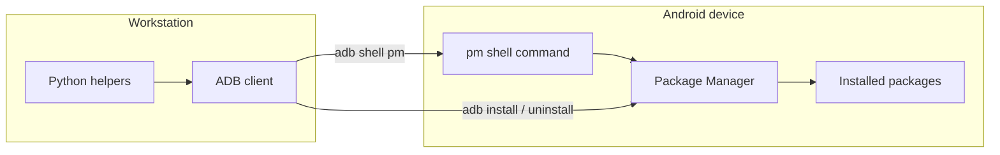

# v0.4: Package manager

Discover installed packages, locate their APKs, and manage a test app with ADB and Python.
The helpers live in `android_cookbook.package_manager`; `package_info` prints an inspection
report as JSON.

## Prerequisites

Complete the [environment setup](../environment.md), run `poetry install`, and confirm an
online device with `adb devices -l`. Run commands from the repository root and replace
`emulator-5554` with your device serial. Use your own test APK and package name wherever
`example.apk` and `com.example.app` appear.

## How packages fit together

An APK supplies application code and resources. An installed package has a name, such as
`com.android.settings`, APK paths, application data, permissions, and components. One
package can have a base APK and additional split APKs. Being installed does not tell you
whether an application process is running.



Package inspection calls use `run_shell()`. Installation and uninstallation call
`run_adb()` directly with a host-side command. See [Architecture](../architecture.md#package-management)
for the command flow and parsing rules.

## Common `adb shell pm` commands

Use `adb -s <serial> shell pm <command>` to query or change packages on a selected device.
Start with the device's help output to check its supported commands and options:

```bash
adb -s emulator-5554 shell pm help
```

The examples below use `com.example.app` as your test app. Command availability and output
can vary by Android version. See the [Android command reference](https://developer.android.com/tools/adb#pm)
and [AOSP shell implementation](https://android.googlesource.com/platform/frameworks/base/+/refs/heads/main/services/core/java/com/android/server/pm/PackageManagerShellCommand.java).

### Inspect packages and the device

Each command in this table follows `adb -s emulator-5554 shell`.

| Command | Use |
| --- | --- |
| `pm list packages` | List installed package names |
| `pm list packages settings` | Find names containing `settings` |
| `pm list packages -s` | List system packages |
| `pm list packages -3` | List third-party packages |
| `pm list packages -e` | List enabled packages |
| `pm list packages -d` | List disabled packages |
| `pm list packages -f` | Include APK file locations |
| `pm list packages -i` | Include installer package names |
| `pm list packages -u` | Include uninstalled package records |
| `pm list packages --user 0` | Query packages for user `0` |
| `pm path com.example.app` | Show base and split APK paths |
| `pm list users` | Find user IDs |
| `pm list permissions -d -g` | List dangerous permissions by group |
| `pm list features` | Inspect device features |
| `pm list libraries` | Inspect available shared libraries |
| `pm list instrumentation` | Find installed instrumentation test packages |

Quick reference for `pm list packages` flags:

```text
-f   associated APK file
-d   disabled
-e   enabled
-s   system
-3   third-party
-i   installer
-u   include uninstalled
```

`-d`, `-e`, `-s`, and `-3` filter the listing. `-f` and `-i` add information to each
entry, while `-u` expands the listing to include uninstalled package records.
These meanings apply to `pm list packages`; other `pm` commands can use the same flags
for different purposes, such as `pm list permissions -d` for dangerous permissions.

For example, inspect a test app for a specific user:

```bash
adb -s emulator-5554 shell pm list users
adb -s emulator-5554 shell pm list packages --user 0 com.example.app
adb -s emulator-5554 shell pm path com.example.app
```

`-u` includes records retained after removal; use the regular listing to check installation.
`-f` and `-i` change the line format. The Python package parser expects plain
`package:<name>` lines, so use `get_package_path()` for APK paths rather than passing
`-f` output to `parse_package_list()`.

### Manage a test app

These commands change app data, availability, or permissions. Replace the example package
with your disposable test app. Each command follows `adb -s emulator-5554 shell`.

| Command | Use |
| --- | --- |
| `pm clear com.example.app` | Delete app data |
| `pm disable-user --user 0 com.example.app` | Disable the app for user `0` |
| `pm enable --user 0 com.example.app` | Enable the app for the same user |
| `pm grant com.example.app android.permission.CAMERA` | Grant a declared runtime permission |
| `pm revoke com.example.app android.permission.CAMERA` | Revoke that runtime permission |
| `pm install -r /data/local/tmp/example.apk` | Reinstall from an APK on the device |
| `pm uninstall com.example.app` | Remove the package |
| `pm uninstall -k com.example.app` | Remove it while retaining data and cache |
| `pm uninstall --user 0 com.example.app` | Remove it for user `0` |

Grant/revoke requires a permission declared by the app and eligible for runtime changes;
it does not grant arbitrary protected permissions. User IDs come from `pm list users`.

`pm install` reads a device-side path. Transfer a local APK before using it:

```bash
adb -s emulator-5554 push ./example.apk /data/local/tmp/example.apk
adb -s emulator-5554 shell pm install -r /data/local/tmp/example.apk
```

For a workstation APK, `adb -s emulator-5554 install -r ./example.apk` performs installation
without a separate push command. The project's `install_apk()` and `uninstall_package()`
use host-side `adb install` and `adb uninstall`; see [installation examples](#4-install-and-uninstall-a-test-app).

The Python API wraps the basic package listing and filters, APK paths, clearing, enabling,
and disabling for a user. The additional inspection commands, user selection for listings,
and permission changes above can be run with `run_shell()`:

```python
from android_cookbook.shell import run_shell

result = run_shell("emulator-5554", "pm", "list", "features")
print(result.output)
```

## 1. List packages

```bash
adb -s emulator-5554 shell pm list packages
```

Example output:

```text
package:com.android.settings
package:com.android.systemui
package:com.example.app
```

Filter the listing with the options described in the
[Android package manager command reference](https://developer.android.com/tools/adb#pm).

| Selection | ADB shell command | Python keyword |
| --- | --- | --- |
| System packages | `pm list packages -s` | `system_only=True` |
| Third-party packages | `pm list packages -3` | `third_party_only=True` |
| Enabled packages | `pm list packages -e` | `enabled_only=True` |
| Disabled packages | `pm list packages -d` | `disabled_only=True` |
| Names containing text | `pm list packages settings` | `filter_text="settings"` |

```python
from android_cookbook.package_manager import list_packages, package_exists

serial = "emulator-5554"
for package in list_packages(serial, system_only=True, filter_text="settings"):
    print(package.name)

print(package_exists(serial, "com.android.settings"))  # Example: True
```

`list_packages()` returns `list[PackageInfo]`; each entry has a `name` field.
`package_exists()` filters the listing, then checks the full name for an exact match.
A substring match alone does not count as installed.

Combining `system_only` with `third_party_only`, or `enabled_only` with `disabled_only`,
raises `ValueError` before calling ADB. Other filter combinations are allowed.

## 2. Locate APKs

```bash
adb -s emulator-5554 shell pm path com.android.settings
```

Example output:

```text
package:/system/priv-app/Settings/Settings.apk
```

```python
from android_cookbook.package_manager import get_package_path

result = get_package_path("emulator-5554", "com.android.settings")
print(result.package_name)
for path in result.paths:
    print(path)
```

The result is `PackagePath(package_name, paths)`. Paths refer to files on the device.
A split installation can return several paths, such as `base.apk` and
`split_config.en.apk`. The helper preserves all accepted paths; it does not pick one APK
or copy files to the workstation. If output contains no non-empty `package:` lines,
`paths` is empty. A failed ADB command raises an exception instead.

## 3. Print a package report

```bash
PYTHONPATH=src poetry run python -m android_cookbook.package_info --package com.android.settings

# The Makefile target inspects com.android.settings
make exec_package_info
```

`--package` is required. The command selects the first device whose state is `device`,
checks the exact package name, and reads APK paths only when the package is found.
Example output, with a device-specific APK path:

```json
{
  "serial": "emulator-5554",
  "package": "com.android.settings",
  "installed": true,
  "apk_paths": [
    "/system/priv-app/Settings/Settings.apk"
  ]
}
```

An absent package produces `"installed": false` and `"apk_paths": []`.
No online device raises `RuntimeError("No Android device available")`.
The CLI has no serial-selection option; use the Python helpers to select a device explicitly.

## 4. Install and uninstall a test app

These examples change the selected device. Use a test app that you can reinstall.
The APK path for installation is on the workstation.

```bash
adb -s emulator-5554 install -r -g ./example.apk
adb -s emulator-5554 uninstall com.example.app
```

```python
from android_cookbook.package_manager import install_apk, uninstall_package

serial = "emulator-5554"
output = install_apk(serial, "./example.apk", replace=True, grant_permissions=True)
print(output)

output = uninstall_package(serial, "com.example.app", keep_data=True)
print(output)
```

Both helpers return ADB standard output with surrounding whitespace removed, rather than
a Boolean. Successful output commonly includes `Success`; installation may also print
progress messages. See the [ADB reference](https://developer.android.com/tools/adb) for
installation and uninstallation options.

| Python option | ADB flag | Effect |
| --- | --- | --- |
| `replace=True` | `install -r` | Reinstall an existing app, keeping its data |
| `grant_permissions=True` | `install -g` | Grant runtime permissions |
| `keep_data=True` | `uninstall -k` | Keep data and cache directories |

Options default to `False`. `install_apk()` accepts a string or `pathlib.Path` and raises
`FileNotFoundError` if the path does not exist. It does not validate APK contents or install
multiple split APKs. Device-side installation failures pass through from ADB.

## 5. Clear data and change enabled state

Clearing data removes the test app's data. Disabling changes its enabled state for a user;
it does not uninstall the package. Use these commands only on your disposable test app.

```bash
adb -s emulator-5554 shell pm clear com.example.app
adb -s emulator-5554 shell pm disable-user --user 0 com.example.app
adb -s emulator-5554 shell pm enable com.example.app
```

```python
from android_cookbook.package_manager import (
    clear_package,
    disable_package_for_user,
    enable_package,
)

serial = "emulator-5554"
print(clear_package(serial, "com.example.app"))
print(disable_package_for_user(serial, "com.example.app", user_id=0))
print(enable_package(serial, "com.example.app"))
```

`clear_package()` returns `True` only when stripped output equals `Success`; another
successful command response returns `False`. A non-zero ADB exit raises an exception.
The enable and disable helpers return stripped command output, not a Boolean.
`disable_package_for_user()` defaults to user `0`. `enable_package()` and `clear_package()`
do not expose a user argument. To choose a user when restoring enabled state, call
`run_shell(serial, "pm", "enable", "--user", str(user_id), package_name)`.
Actual state messages and permission restrictions depend on the device.

## 6. Run the tests

The test commands in this recipe are targeted development checks. Before every
commit, follow the [full commit verification procedure](../../CommitManual.md#run-the-full-integration-suite):
rebuild the APK, run all unit tests and the entire integration suite (including
destructive tests), and require every test to pass without skips or deselection.
Use only a dedicated online emulator and run sequentially.

```bash
# No device required
PYTHONPATH=src poetry run pytest tests/unit/test_package_manager.py -v

# Requires ADB and an online emulator
export ANDROID_SERIAL=emulator-5554
PYTHONPATH=src poetry run pytest tests/integration/test_package_manager.py -m integration -v
```

Unit tests cover package-line parsing, listings, system and third-party flags, conflicting
filters, existence checks, single and multiple APK paths, path-command arguments, clear
responses, installation options, missing APKs, and basic uninstallation. ADB calls are
replaced with sample responses; the APK fixtures are placeholder bytes.

Integration tests query the emulator selected by `ANDROID_SERIAL` for a non-empty
package listing, the `com.android.settings` package and its APK paths, and system
packages. They skip unless the selected serial starts with `emulator-` and reports
state `device`. They do not install, uninstall, clear, enable, or disable apps.
The focused Package Manager tests do not directly cover enable/disable helpers, enabled/disabled command flags,
substring versus exact-name matching, `keep_data=True`, or the JSON entry point.

For installation, clearing, and removal tests, continue with
[v0.4.1: Package lifecycle](v0.4.1-package-lifecycle.md). That separate test module mutates
the disposable fixture app and marks all five tests as `destructive`.

## Troubleshooting

- Missing `--package`: supply the required argument; the CLI does not use a default package.
- `ModuleNotFoundError: android_cookbook`: run from the repository root with `PYTHONPATH=src`.
- No online device or skipped tests: check `adb devices -l` and confirm that `ANDROID_SERIAL`
  selects an online emulator as described in [environment setup](../environment.md#3-prepare-a-device).
- Missing ADB: ensure Platform Tools is on `PATH`. A missing executable raises
  `FileNotFoundError`.
- `CalledProcessError`: run the corresponding ADB command directly to inspect its error.
  The wrappers do not convert failures into empty lists or `False`.
- Settings integration tests fail: those tests assume the device includes
  `com.android.settings`; inspect the actual package listing on your Android build.
