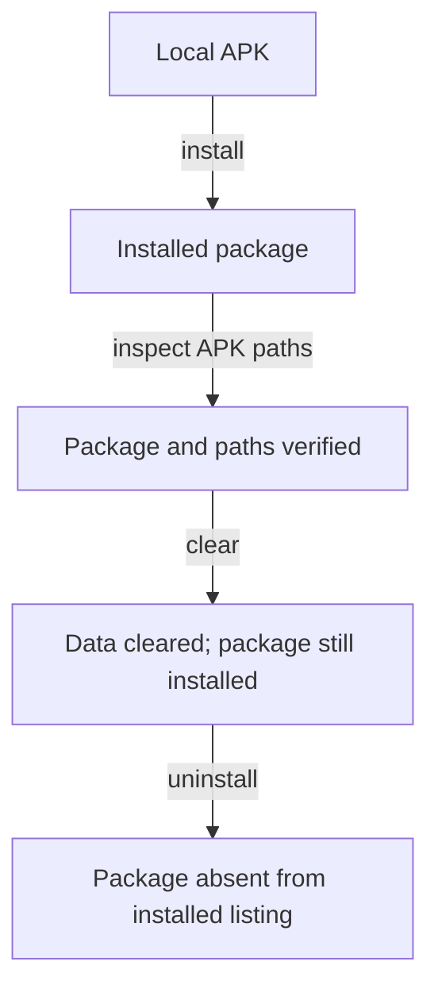

# v0.4.1: Package lifecycle

Install a disposable test APK, inspect its paths, clear its data, and uninstall it.
This recipe combines the [package manager helpers](v0.4-package-manager.md) into a
repeatable sequence and explains how pytest fixtures prepare and clean up device state.

## Prerequisites

Complete the [environment setup](../environment.md) and run commands from the repository
root. Confirm an online device with `adb devices -l`; replace `emulator-5554` below with
its serial.

The integration tests expect a local APK at
`tests/fixtures/test_app/cookbook-test-app.apk` with package name
`com.example.androidcookbook.fixture`. **The checked-in file is empty.** Replace it with
a valid, compatible test APK before running device tests. See the
[test app requirements](../../tests/fixtures/test_app/README.md).

The tests uninstall any existing app with that package name during setup and cleanup.
Use a disposable device or emulator and a test app whose data can be deleted.

## 1. Understand the lifecycle



Installation, clearing, and uninstallation have separate checks. A successful clear
response does not establish that the app remains installed; the sequence queries that
state again. After uninstallation, it checks the installed listing again as well.
The tests do not create app data and inspect it after clearing, so they verify the clear
response and continued installation, rather than independently verifying data deletion.

## 2. Run the commands directly

```bash
adb -s emulator-5554 install -r tests/fixtures/test_app/cookbook-test-app.apk
adb -s emulator-5554 shell pm list packages com.example.androidcookbook.fixture
adb -s emulator-5554 shell pm path com.example.androidcookbook.fixture
adb -s emulator-5554 shell pm clear com.example.androidcookbook.fixture
adb -s emulator-5554 shell pm list packages com.example.androidcookbook.fixture
adb -s emulator-5554 uninstall com.example.androidcookbook.fixture
adb -s emulator-5554 shell pm list packages com.example.androidcookbook.fixture
```

Example responses for a successful run, in command order. Installation progress and APK
paths depend on the device; the final listing has no matching package line.

```text
Success
package:com.example.androidcookbook.fixture
package:/data/app/example/base.apk
Success
package:com.example.androidcookbook.fixture
Success
```

The listing filter can return names containing the supplied text. The Python
`package_exists()` helper compares full names before reporting a match.

## 3. Run the Python helper

`run_package_lifecycle(serial, apk_path, package_name)` accepts an explicit device serial,
a workstation APK path (`str` or `Path`), and the APK's package name. It has no CLI entry
point. To print its result as JSON:

```bash
PYTHONPATH=src poetry run python - <<'PYTHON'
from dataclasses import asdict
import json

from android_cookbook.package_lifecycle import run_package_lifecycle

result = run_package_lifecycle(
    "emulator-5554",
    "tests/fixtures/test_app/cookbook-test-app.apk",
    "com.example.androidcookbook.fixture",
)
print(json.dumps(asdict(result), indent=2))
PYTHON
```

Example output for a successful run:

```json
{
  "package_name": "com.example.androidcookbook.fixture",
  "installed": true,
  "apk_paths": ["/data/app/example/base.apk"],
  "cleared": true,
  "still_installed_after_clear": true,
  "uninstalled": true,
  "removed": true
}
```

The returned `PackageLifecycleResult` is a frozen dataclass. Its fields cannot be reassigned,
but its `apk_paths` list remains mutable.

| Field | How the helper obtains it |
| --- | --- |
| `package_name` | The supplied package name |
| `installed` | Exact package lookup after installation |
| `apk_paths` | Paths returned by `pm path` after installation |
| `cleared` | Whether stripped `pm clear` output equals `Success` |
| `still_installed_after_clear` | Exact package lookup after clearing |
| `uninstalled` | Whether stripped uninstall output equals `Success` |
| `removed` | Whether the final exact package lookup finds no package |

The helper installs with `replace=True`, does not grant runtime permissions, and uninstalls
without retaining data. It ignores installation output and records later observations.
It does not assert that fields are true or stop when a Boolean check is false.

Exceptions from the underlying helpers pass through. There is no `try/finally` cleanup
in `run_package_lifecycle()`; a failure before uninstallation can leave the app installed.
The helper also does not validate that the supplied package name matches the APK.

## 4. Prepare and clean up with fixtures

The integration tests use three fixtures from `tests/integration/conftest.py`:

| Fixture | Responsibility |
| --- | --- |
| `android_serial` | Choose the first online device; skip if none exists |
| `test_apk` | Return the expected APK path; skip if the file is missing |
| `clean_test_package` | Uninstall an existing fixture package before yielding its name; check and uninstall again during teardown |

These fixtures use pytest's default function scope, so each test gets its own setup and
teardown. `test_apk` checks file existence only; an empty or invalid APK reaches ADB.
Cleanup does not restore an app or its data that existed before the test. Setup or
teardown ADB failures can prevent a test from completing.

```text
Fixture resources → Setup → Exercise → Verify → Teardown
APK and device    → Remove existing app → Package operations → Assertions → Remove app
```

The same structure can guide other tests: a browser fixture prepares a session and quits
it after assertions; a device or recorder fixture can prepare resources, run a scenario,
collect artifacts, and release resources. Browser sessions, recording, artifact collection,
and global setup are design examples; this repository does not implement them.

## 5. Run the tests

```bash
# Helper result and operation order; no device required
PYTHONPATH=src poetry run pytest tests/unit/test_package_lifecycle.py -v

# Install, inspect, clear, and uninstall on the first online device
PYTHONPATH=src poetry run pytest tests/integration/test_package_lifecycle.py -v -rxX

# Run only integration tests that do not carry the destructive marker
PYTHONPATH=src poetry run pytest tests/integration -m "integration and not destructive"
```

The two unit tests replace package operations with sample responses. They check the returned
result and the order `install → exists → path → clear → exists → uninstall → exists`.
They do not directly check failure paths, cleanup on exceptions, or the `replace=True` argument.

The five integration tests check installation, APK paths, clearing without removal,
uninstallation, and the complete sequence. They call package manager helpers directly;
they do not call `run_package_lifecycle()`. All five carry the `integration` and
`destructive` markers and an unconditional `xfail` marker with no reason specified.

`XFAIL` means pytest treated a failure as expected; that failure can occur during fixture
setup before installation is attempted. It does not validate the lifecycle.
`XPASS` means an expected-failure test passed. With the current non-strict markers, XPASS
does not fail the suite. To expose failures
as ordinary failures after providing a valid APK, run:

```bash
PYTHONPATH=src poetry run pytest tests/integration/test_package_lifecycle.py --runxfail -v
```

The default integration command and `make test` include these device mutations; the
`destructive` marker labels tests but does not disable them.

## Troubleshooting

- Installation fails: the checked-in APK is empty. Supply a valid APK with the required
  package name and compatible Android API level.
- Tests skip: check for an online device and the expected APK file.
- Missing ADB or failed commands: check Platform Tools on `PATH` and run the corresponding
  ADB command directly to inspect its error.
- A helper run leaves the package installed: check its state and remove the disposable app
  with `adb -s emulator-5554 uninstall com.example.androidcookbook.fixture`.
- Unexpected result fields: confirm the APK's package name matches the supplied name and
  inspect package listings on the selected device.
