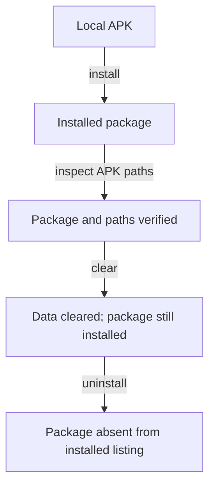
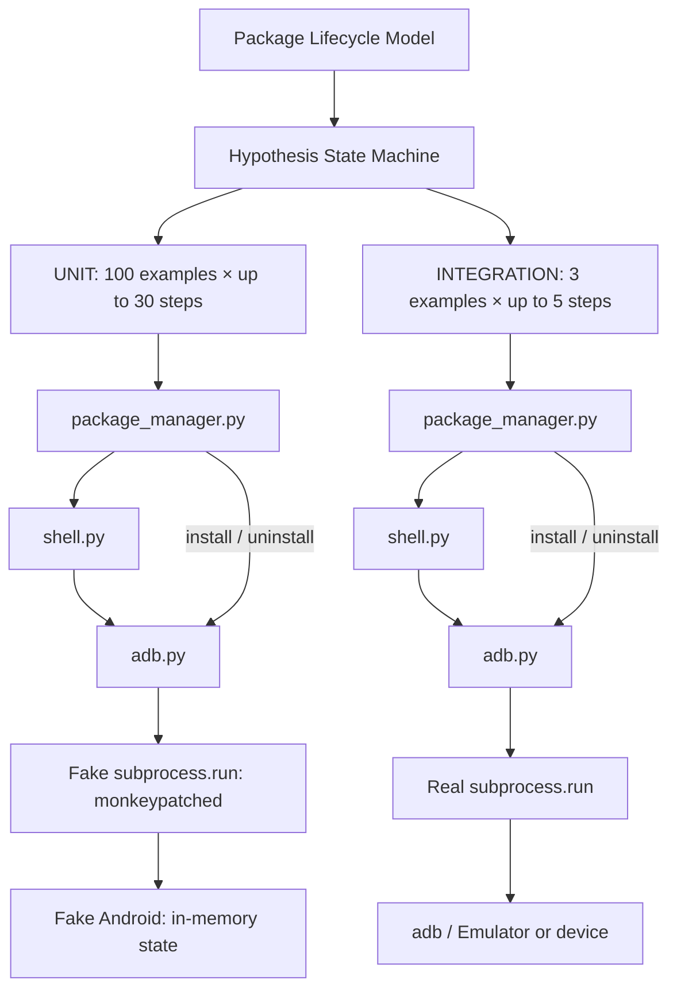

# v0.4.1: Package lifecycle

Install a disposable test APK, inspect its paths, clear its data, and uninstall it.
This recipe combines the [package manager helpers](v0.4-package-manager.md) into a
repeatable sequence, explains how pytest fixtures prepare and clean up device state,
and compares Hypothesis state machine tests through production package manager code
against simulated Android responses and real Android.

## Prerequisites

Complete the [environment setup](../environment.md) and run commands from the repository
root. Confirm an online device with `adb devices -l`; replace `emulator-5554` below with
its serial.

The integration tests expect a local APK at
`tests/fixtures/test-app/cookbook-test-app.apk` with package name
`com.example.androidcookbook.fixture`. Build it with `./scripts/build-test-apk.sh`.
See [Build the test APK](v0.4.2-test-apk-fixture.md#build-the-test-apk) for Java,
Gradle, and Android Environment build tools. Use a device running API 31 or later.

The tests uninstall any existing app with that package name during setup and cleanup.
Use a disposable device or emulator and a test app whose data can be deleted.

## 1. Understand the lifecycle



Installation, clearing, and uninstallation have separate checks. A successful clear
response does not establish that the app remains installed; the sequence queries that
state again. After uninstallation, it checks the installed listing again as well.
The tests do not create app data and inspect it after clearing, so they verify the clear
response and continued installation, rather than independently verifying data deletion.

## 2. Run the commands directly

```bash
adb -s emulator-5554 install -r -t tests/fixtures/test-app/cookbook-test-app.apk
adb -s emulator-5554 shell pm list packages com.example.androidcookbook.fixture
adb -s emulator-5554 shell pm path com.example.androidcookbook.fixture
adb -s emulator-5554 shell pm clear com.example.androidcookbook.fixture
adb -s emulator-5554 shell pm list packages com.example.androidcookbook.fixture
adb -s emulator-5554 uninstall com.example.androidcookbook.fixture
adb -s emulator-5554 shell pm list packages com.example.androidcookbook.fixture
```

Example responses for a successful run, in command order. Installation progress and APK
paths depend on the device; the final listing has no matching package line.

```text
Performing Streamed Install
Success
package:com.example.androidcookbook.fixture
package:/data/app/example/base.apk
Success
package:com.example.androidcookbook.fixture
Success
```

The listing filter can return names containing the supplied text. The Python
`package_exists()` helper compares full names before reporting a match.

## 3. Run the Python helper

`run_package_lifecycle(serial, apk_path, package_name)` accepts an explicit device serial,
a workstation APK path (`str` or `Path`), and the APK's package name. It has no CLI entry
point. To print its result as JSON:

```bash
PYTHONPATH=src poetry run python - <<'PYTHON'
from dataclasses import asdict
import json

from android_cookbook.package_lifecycle import run_package_lifecycle

result = run_package_lifecycle(
    "emulator-5554",
    "tests/fixtures/test-app/cookbook-test-app.apk",
    "com.example.androidcookbook.fixture",
)
print(json.dumps(asdict(result), indent=2))
PYTHON
```

Example output for a successful run:

```json
{
  "package_name": "com.example.androidcookbook.fixture",
  "installed": true,
  "apk_paths": ["/data/app/example/base.apk"],
  "cleared": true,
  "still_installed_after_clear": true,
  "uninstalled": true,
  "removed": true
}
```

The returned `PackageLifecycleResult` is a frozen dataclass. Its fields cannot be reassigned,
but its `apk_paths` list remains mutable.

| Field | How the helper obtains it |
| --- | --- |
| `package_name` | The supplied package name |
| `installed` | Exact package lookup after installation |
| `apk_paths` | Paths returned by `pm path` after installation |
| `cleared` | Whether stripped `pm clear` output equals `Success` |
| `still_installed_after_clear` | Exact package lookup after clearing |
| `uninstalled` | Whether stripped uninstall output equals `Success` |
| `removed` | Whether the final exact package lookup finds no package |

The helper installs with `replace=True`, does not grant runtime permissions, and uninstalls
without retaining data. It ignores installation output and records later observations.
It does not assert that fields are true or stop when a Boolean check is false.

Exceptions from the underlying helpers pass through. There is no `try/finally` cleanup
in `run_package_lifecycle()`; a failure before uninstallation can leave the app installed.
The helper also does not validate that the supplied package name matches the APK.

## 4. Prepare and clean up with fixtures

The five fixed-sequence integration tests in `test_package_lifecycle.py` use three
fixtures from `tests/integration/conftest.py`. The state machine test described below
manages its own setup and teardown:

| Fixture | Responsibility |
| --- | --- |
| `android_serial` | Require `ANDROID_SERIAL` selecting an online `emulator-*`; otherwise skip |
| `test_apk` | Return the expected APK path; skip if the file is missing |
| `clean_test_package` | Fail if the fixture package is already installed; attempt force-stop and uninstall during teardown |

`android_serial` and `test_apk` are session-scoped. `clean_test_package` is
function-scoped, so each test gets its own package setup and teardown. `test_apk` checks file existence only; an empty or invalid APK reaches ADB.
Cleanup does not restore an app or its data that existed before the test. Setup or
teardown ADB failures can prevent a test from completing.

```text
Fixture resources → Setup → Exercise → Verify → Teardown
APK and emulator  → Require absent app → Package operations → Assertions → Stop/remove app
```

The same structure can guide other tests: a browser fixture prepares a session and quits
it after assertions; a device or recorder fixture can prepare resources, run a scenario,
collect artifacts, and release resources. Browser sessions, recording, artifact collection,
and global setup are design examples; this repository does not implement them.

## 5. Run the tests

The test commands in this recipe are targeted development checks. Before every
commit, follow the [full commit verification procedure](../../CommitManual.md#run-the-full-integration-suite):
rebuild the APK, run all unit tests and the entire integration suite (including
destructive tests), and require every test to pass without skips or deselection.
Use only a dedicated online emulator and run sequentially.

```bash
# Helper result and operation order; no device required
PYTHONPATH=src poetry run pytest tests/unit/test_package_lifecycle.py -v

# Run the five lifecycle integration tests with the APK on the selected emulator
export ANDROID_SERIAL=emulator-5554
PYTHONPATH=src poetry run pytest tests/integration/test_package_lifecycle.py \
  -m "integration and destructive" -v -rs

# Run only integration tests that do not carry the destructive marker
PYTHONPATH=src poetry run pytest tests/integration -m "integration and not destructive"
```

The two unit tests replace package operations with sample responses. They check the returned
result and the order `install → exists → path → clear → exists → uninstall → exists`.
They do not directly check failure paths, cleanup on exceptions, or the `replace=True` argument.

The five integration tests check installation, APK paths, clearing without removal,
uninstallation, and the complete sequence. They call package manager helpers directly
and carry the `integration` and `destructive` markers. Build the fixture APK and connect
an online device before running them; no skip decorators need to be removed.
The shared fixtures skip if the APK is missing or the selected emulator is unavailable.
An unset or non-emulator `ANDROID_SERIAL` also skips these tests. An empty or invalid
APK still fails during installation because the fixed-sequence fixture checks only
file existence.

`pytest.ini` excludes destructive tests by default. `make test` includes them in the
full suite, and `make test_all_integration` includes them in the integration suite.
Use `-m "integration and not destructive"` to exclude them explicitly.

## 6. Test the package lifecycle as a state machine

The fixed-sequence tests exercise selected scenarios. The new Hypothesis tests generate
sequences of valid package operations and compare observed state with a lifecycle model.
Both test files define their own `PackageState` enum and rules with the same intended
transitions; they do not import a shared state machine implementation or call
`run_package_lifecycle()`.



Both layers exercise the production `package_manager.py` helpers. Shell package commands
pass through `shell.py` and `adb.py`; installation and uninstallation call `adb.py`
directly. The unit state machine replaces only `subprocess.run` through
`pytest.MonkeyPatch`, while the integration state machine invokes the real process.
Package manager helpers, shell command construction, ADB command construction, and
response parsing still execute in the unit test.

The broad unit layer checks generated sequences without launching ADB; the smaller
device layer checks the same intended lifecycle model against Android when a real APK
is available. `max_examples` and `stateful_step_count` configure the example and step
budgets, rather than guaranteeing exactly 3,000 or 15 transitions. Invariant queries,
setup, and cleanup add work beyond the generated transitions. Both tests set
`deadline=None`.

| Test | Process boundary and backend | Hypothesis settings | Current behavior |
| --- | --- | --- | --- |
| `tests/unit/test_package_lifecycle_state_machine.py` | Production helpers → monkeypatched `subprocess.run` → fake Android state | `max_examples=100`, `stateful_step_count=30` | Runs without ADB, an Android device, or a valid APK; creates a temporary placeholder file |
| `tests/integration/test_package_lifecycle_state_machine.py` | Production helpers → real `subprocess.run` → ADB / Android | `max_examples=3`, `stateful_step_count=5` | Skips while the APK is missing or empty; also skips if no device is online |

### States, rules, and invariants

The model describes installation and enabled state for one package and user 0. Enabled
state does not describe whether the app process is running.

| Rule | Precondition | Resulting model state |
| --- | --- | --- |
| `install` | `NOT_INSTALLED` | `ENABLED`; explicitly enable after installing |
| `disable` | `ENABLED` | `DISABLED` for user 0 |
| `enable` | `DISABLED` | `ENABLED` |
| `clear_data` | `ENABLED` or `DISABLED` | Preserve the current state |
| `uninstall` | `ENABLED` or `DISABLED` | `NOT_INSTALLED` |

The presence invariant compares `package_exists()` with the model's installed state.
The enabled-state invariant checks exact package-name matches in enabled and disabled
package listings. The unit test checks those listings in every state; the integration
test leaves the absent-package check to the presence invariant and checks enabled and
disabled listings only while installed. Clearing checks a successful response and
continued installation; it does not independently inspect app data deletion.

The unit test keeps two independent representations of state: `self.state` is the
expected lifecycle model, while `android_installed` and `android_enabled` represent the
simulated Android backend. Rules call production helpers and update the expected model;
the fake backend updates its own flags in response to the generated ADB commands.
The invariants query production helpers and compare the parsed responses with the model.
Deriving fake responses directly from `self.state` would hide disagreements between the
model and the commands under test.

The fake process returns stdout and a successful process return code for the supported
install, uninstall, package listing, clear, enable, and disable-user commands. It records
commands and responses for debugging and rejects unsupported commands. This exercises
command construction and response handling for those sequences, but the simulator is
simplified: it does not strictly validate every command argument or reproduce process
failures and all Android behavior. Real-device integration provides the additional
check against ADB and Android, with fewer examples because operations and invariants
can each launch a process.

Each unit example creates a temporary APK placeholder so `install_apk()` performs its
normal file-existence check. The file is not a valid APK and is never installed on a
device. Its `teardown()` restores `subprocess.run` with `monkeypatch.undo()` and removes
the temporary directory. The integration example instead prepares and cleans up the
fixture package on a real device.

### Run and enable the state machine tests

Hypothesis is included in the project's dependencies installed by `poetry install`.

```bash
# Production helpers with a fake subprocess / Android backend; no device required
PYTHONPATH=src poetry run pytest tests/unit/test_package_lifecycle_state_machine.py -v

# Requires the built APK and an online device
PYTHONPATH=src poetry run pytest tests/integration/test_package_lifecycle_state_machine.py -m "integration and destructive" -v -rs
```

The integration state machine has `integration` and `destructive` markers. It uses a
conditional `pytest.skip()` during initialization, rather than an unconditional
`@pytest.mark.skip` decorator. It checks that the APK is a non-empty file before device
discovery or mutations. This check does not validate APK contents or its package name.
Build the APK with `./scripts/build-test-apk.sh`, connect an online disposable device,
and rerun the integration command above. No skip decorators need to be removed.
The install rule passes `replace=True` and `allow_test_packages=True`, and checks the
streamed-install response `Performing Streamed Install\nSuccess`.

For each generated example, the state machine selects the first online device and removes
any existing fixture package before executing rules. Its `teardown()` removes the package
again and checks that it is absent. It manages this lifecycle itself instead of using the
function-scoped fixtures. Cleanup deletes the fixture app and does not restore prior data;
ADB failures can interrupt setup or cleanup. Select `-m "integration and destructive"`
to run these mutations in a targeted run. `make test` includes them in the full suite. Use
`-m "integration and not destructive"` to exclude them.

## Troubleshooting

- Installation fails: rebuild the APK, use a device running API 31 or later, and pass
  `-t` when installing a test-only APK directly with ADB.
- Fixed-sequence tests skip if the fixture APK is missing or `ANDROID_SERIAL` fails
  to select an online `emulator-*` device.
- State machine integration test skips: supply a valid,
  non-empty APK at the expected path and connect an online device; no decorator change
  is needed for this test.
- Missing ADB or failed commands: check Platform Tools on `PATH` and run the corresponding
  ADB command directly to inspect its error.
- A helper run leaves the package installed: check its state and remove the disposable app
  with `adb -s emulator-5554 uninstall com.example.androidcookbook.fixture`.
- Unexpected result fields: confirm the APK's package name matches the supplied name and
  inspect package listings on the selected device.
